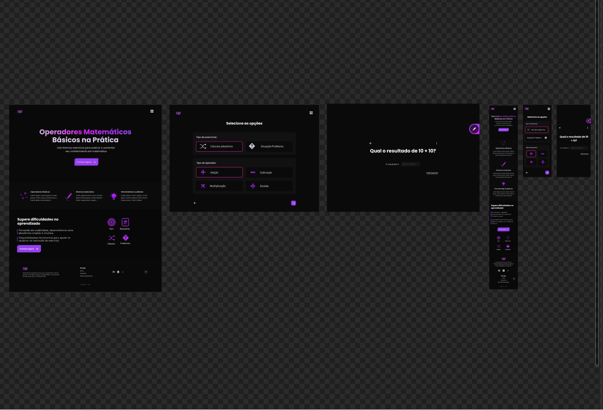

<h1 align="center">FunMath!</h1>

<p align="center">Plataforma web para praticar os quatro operadores matemáticos básicos com exercícios gerados e situações do dia a dia.</p>

**Produção:** [https://fun-math.vercel.app/](https://fun-math.vercel.app/)

<br />

<p align="center">
  
</p>

# Sobre

O FunMath! é uma aplicação web para praticar os quatro operadores matemáticos básicos. A matemática do dia a dia passa por adição, subtração, multiplicação e divisão o tempo todo, mas muita gente ainda trava no básico; o projeto junta exercícios em um fluxo único em vez de depender só de listas soltas ou material genérico.

Hoje o sistema oferece cálculos aleatórios, gerados sob demanda para cada operador, e situações-problema, com enunciados em contexto cotidiano para treinar quando usar cada operação. Na resolução entram conferência de resposta, feedback de acerto ou erro e troca de exercício. As ferramentas de apoio incluem tabela de multiplicação, textos de teoria, dicas ligadas ao exercício atual e área de rascunho para raciocinar enquanto resolve. Há ainda uma área livre com canvas, fora de qualquer exercício, para trabalhar contas e ideias do mesmo jeito.

# Ferramentas

- [Next.js](https://nextjs.org/) (Pages Router e API Routes)
- [React](https://react.dev/) e [TypeScript](https://www.typescriptlang.org/)
- [Redux Toolkit](https://redux-toolkit.js.org/)
- [SWR](https://swr.vercel.app/)
- [Tailwind CSS](https://tailwindcss.com/)
- [Headless UI](https://headlessui.com/)
- [Jest](https://jestjs.io/) e [React Testing Library](https://testing-library.com/docs/react-testing-library/intro/)

# Rodando o projeto

Você precisa do [Node.js](https://nodejs.org/), [Git](https://git-scm.com/) e [npm](https://docs.npmjs.com/).

1. Clone o repositório:

```bash
git clone https://github.com/gabriellima2/fun-math.git
cd fun-math
```

2. Instale as dependências:

```bash
npm install
```

3. Inicie o app:

```bash
npm run dev
```

A aplicação abre em [http://localhost:3000](http://localhost:3000) (porta definida no script `dev`).

**Scripts adicionais:**

```bash
npm run build    # build de produção
npm run start    # serve o build (após build)
npm run lint     # ESLint (Next.js)
npm run test     # Jest com cobertura
```

<h4 align="center">Projeto feito com 💙 por Gabriel Lima</h4>